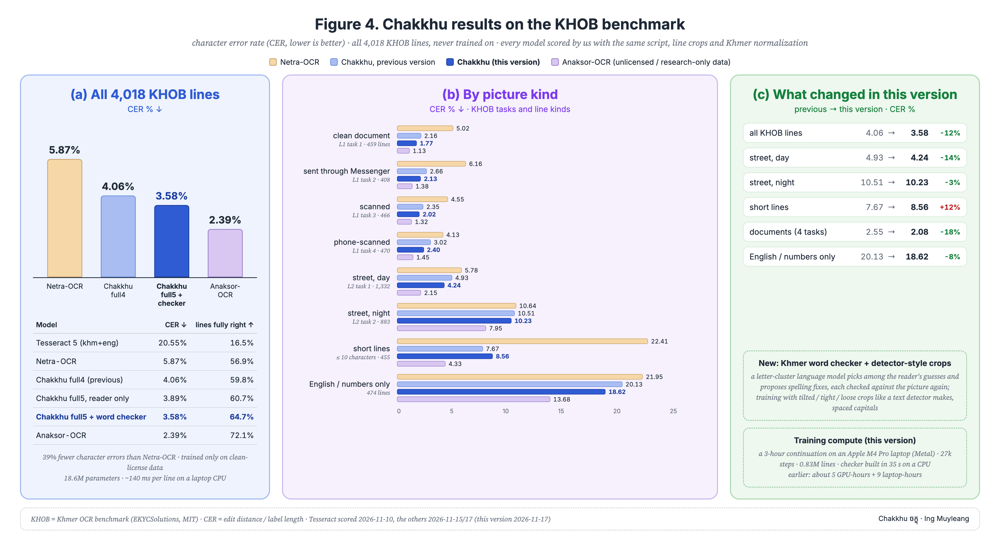
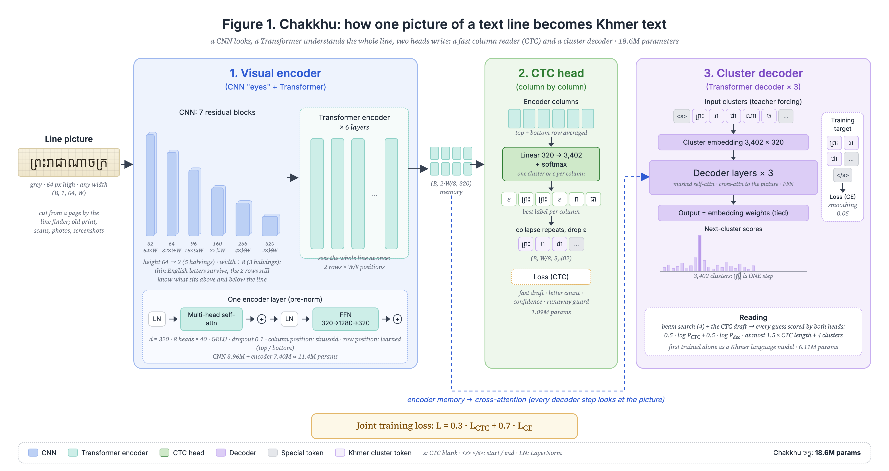
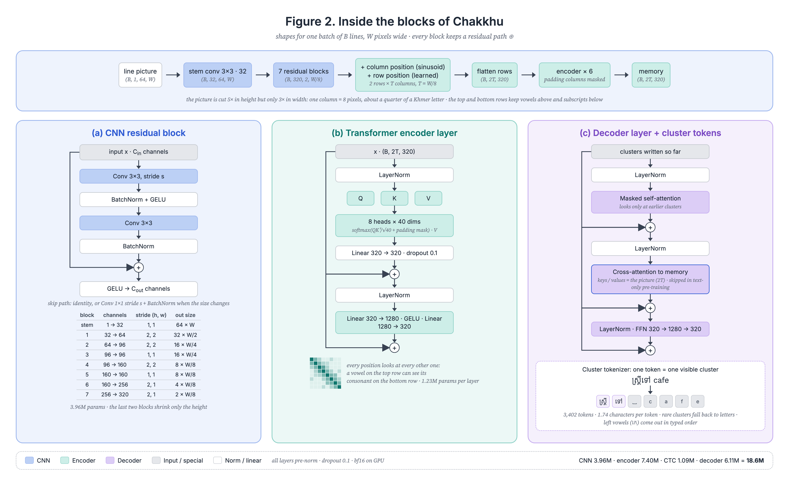
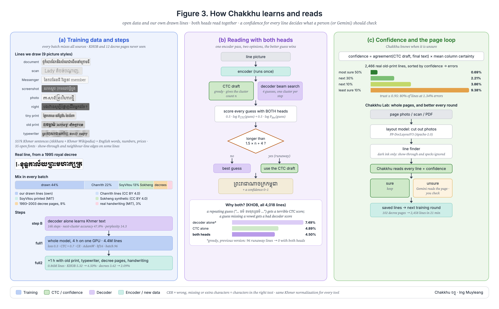

# Chakkhu ចក្ខុ: Khmer + English OCR

**Chakkhu** (ចក្ខុ, "eye") reads **Khmer and English text lines** from pictures: documents, old printed and
typewritten pages, scans, phone photos of paper, screenshots, chat pictures and signs. It is small
(18.6M parameters), runs on a CPU, and tells you **how sure it is** about every line.

- **3.60% character error rate** on the full [KHOB benchmark](https://github.com/EKYCSolutions/khmer-ocr-benchmark-dataset) (all 4,018 real text lines, never trained on) with the **Khmer word checker**; 3.89% without it; Netra-OCR 5.87%
- **new in this version (full6):** trained 3 more hours with **English signs, web / email / phone lines, Khmer
  reference codes** (`លេខ : ១១៤ / ២១ សជណ.អ`) and **look-alike Khmer / Latin letters**
  - KHOB: the same as full5 (3.60% vs 3.58%), but more lines fully right (65.1%, was 64.7%) and better short lines (7.88%, was 8.42%)
  - **whole street photos**: 22.1% character errors (was 23.0%)
  - on our new test of 200 such lines drawn with unseen fonts: email / web / phone lines fully right 94% (was 86%)
- a **Khmer word checker** (`checker/`, CPU, no extra model): a letter-cluster language model built from our clean training text picks among the reader's guesses and proposes spelling fixes, and every fix is checked against the picture again (`សេដ្ឋកិបូ → សេដ្ឋកិច្ច`)
- a **confidence** (0–1) for every line, to decide which lines a person should check
- about 140 ms per line on a laptop CPU, ~20 ms on a GPU
- writes whole Khmer letter **clusters** (ស្ត្រី = 1 step), so subscripts and left-drawn vowels come out in typed order

**Whole documents too:** PDF / photo → Word, and **tables → Excel / CSV** (numbers as numbers): see
[Whole documents and tables](#whole-documents-and-tables-pdf--photo--word-excel-csv).

Demo + free API: [muyleanging/Chakkhu-OCR-Demo](https://huggingface.co/spaces/muyleanging/Chakkhu-OCR-Demo) · ONNX (no PyTorch, int8, 39 MB): [muyleanging/Chakkhu-OCR-Khmer-ONNX](https://huggingface.co/muyleanging/Chakkhu-OCR-Khmer-ONNX) · Made by **Ing Muyleang**.

## Results (KHOB, all 4,018 lines)



| Model | Training data | Character errors (CER) ↓ | Lines fully right ↑ |
|---|---|---|---|
| Tesseract 5 (khm+eng, best) | | 20.55% | 16.5% |
| Netra-OCR | includes research-only data | 5.87% | 56.9% |
| Chakkhu full5 + word checker (previous version) | clean licenses only | 3.58% | 64.7% |
| Chakkhu full6 (this version, reader only) | clean licenses only | 3.89% | 61.0% |
| **Chakkhu full6 + word checker** | **clean licenses only** | **3.60%** | **65.1%** |
| Anaksor-OCR (rec-v4) | includes unlicensed / research-only data | 2.39% | 72.1% |

By picture kind (CER %):

| KHOB task | Netra-OCR | full5 + checker (previous) | Chakkhu full6 | **full6 + checker** | Anaksor-OCR |
|---|---|---|---|---|---|
| clean document | 5.02 | 1.75 | 2.01 | **1.70** | 1.13 |
| sent through Messenger | 6.16 | 2.14 | 2.47 | **2.11** | 1.38 |
| scanned | 4.55 | **2.02** | 2.28 | **2.02** | 1.32 |
| phone-scanned | 4.13 | **2.42** | 3.08 | 2.54 | 1.45 |
| street, day | 5.78 | **4.25** | 4.62 | 4.39 | 2.15 |
| street, night | 10.64 | 10.23 | **10.11** | 10.17 | 7.95 |
| short lines (≤ 10 chars, 455 lines) | | 8.42 | 8.25 | **7.88** | |
| English / numbers only (474 lines) | | 18.72 | 18.72 | **18.35** | |

full6 is a little worse than full5 on phone-scanned pages and daylight street lines, better on night streets and
short lines. **Whole street photos** (the demo's Photo mode on 120 KHOB street photos: find the text, then read it):
full4 24.0%, full5 23.0%, **full6 22.1%** character errors, lines found 91.8%. The checker is not used in Photo mode.

**English, contacts and codes** (new test, 200 lines we drew with Mac system fonts that training never used; lines fully right):

| Lines | full5 | **full6** |
|---|---|---|
| English signs (`Welcome to Royal Spa & Massage`) | 88% | 88% |
| email / web / phone (`Email: sokha@moeys.gov.kh`, `ទូរស័ព្ទ៖ ០១២ ...`) | 86% | **94%** |
| Khmer reference codes (`លេខ៖ ៤១៨ ក.យ.ក.អ`) | 100% | 98% |
| Khmer + English in one line (`វគ្គ English for Kids ម៉ោង 3PM`) | 92% | 92% |
| all 200 | 91.5% | **93.0%** |

**How the checker was tested fairly:** every KHOB sentence was removed from the checker's text before testing, and its
settings were tuned on one half of the lines and scored on the other half (and the other way round). The published
checker is built from all of our training text.

[Anaksor-OCR](https://huggingface.co/Sokheng/anaksor-ocr) (SVTRv2-B, fine-tuned from a large pretrained model) is the most
accurate Khmer recognizer we know of; its training data includes KhmerST, khmer-hanuman-100k and KhmerSynthetic1M,
which have no license or are research-only. Chakkhu is trained only on data whose license allows any use.

All models were scored by us with the same script, the same line crops and the same Khmer text normalization
(`chakkhu/khnormal.py`: one fixed order inside every cluster, split vowels joined, invisible characters removed —
NFC alone does not do this for Khmer). KHOB level-1 tasks 2–4 use the task-1 boxes aligned to each picture; two
pages that show a different letter were left out. The reader's CTC weight (0.5) was set before scoring; 0.3 and
0.7 give 3.95% and 3.93% (full5). Tesseract was scored on 2026-11-10, the others on 2026-11-15/17/19 (KHOB release of 2026-01-31).

**Old government documents:** the previous version read 12 held-out pages of 1993–2003 decrees at 2.09% CER. Those
test pages were not available for this version, so it was not measured again; on KHOB's government documents its
error rate is a little lower than before.

**Weaker on:** night street photos, curved and vertical text (round seals, logos), very short sign words, decorative
fonts, and English-only lines in general. Handwriting: some (2,311 real lines in training), not measured yet.

## How it works





```
line picture (grey, 64 px high)
  → CNN            ResNet blocks: 64 × W → 2 rows × W/8 columns
  → Transformer    6 layers, d 320, sees the whole line
  ├→ CTC head      per column: a cluster or <blank>  (fast draft, letter count)
  └→ decoder       3 layers, writes one Khmer cluster per step; first trained as a language model on Khmer text
```

**Reading with both heads:** the decoder writes its 4 best guesses (beam search), the CTC draft is added, and
each guess is scored by both heads (`0.5 · CTC + 0.5 · decoder`). A guess that repeats or skips words gets a bad
CTC score; a guess with a missing vowel gets a bad decoder score.

**Confidence:** `agreement of the two heads × how sure the CTC columns are`. Use it to decide which lines a person
(or a bigger model) should check.

Vocabulary: 3,402 tokens (Khmer clusters + Latin, digits, punctuation; rare clusters fall back to single
characters, so any text can be written).

## Use it

```bash
pip install torch pillow safetensors huggingface_hub rapidfuzz
```

```python
from huggingface_hub import snapshot_download
import sys
folder = snapshot_download("muyleanging/Chakkhu-OCR-Khmer")
sys.path.insert(0, folder)
from chakkhu import load, read

model, tok = load(folder)                               # CPU; load(folder, device="cuda") for a GPU
print(read(model, tok, ["line.png"]))                   # one picture = one text line
print(read(model, tok, ["line.png"], confidence=True))  # [("…", 0.98)]
# read(..., beam=0) → faster, CTC head only

# + the Khmer word checker (about 1.5× slower, fewer spelling mistakes)
from chakkhu import Checker
checker = Checker.load(f"{folder}/checker")
print(read(model, tok, ["line.png"], checker=checker))
```

Whole pages: the [demo](https://huggingface.co/spaces/muyleanging/Chakkhu-OCR-Demo) has a line finder, and a free API:

```python
from gradio_client import Client, handle_file
c = Client("muyleanging/Chakkhu-OCR-Demo")
c.predict(handle_file("page.jpg"), "page", api_name="/read")
# → {"text": …, "lines": [{"text", "confidence", "box": [x, y, w, h]}], "ms": …}
```

## Whole documents and tables: PDF / photo → Word, Excel, CSV

Chakkhu reads lines; around it, the same engine as [Chakkhu Studio](https://chakkhu-studio.muyleanging.com)
finds the **blocks of a page** (titles, paragraphs, lists, **tables**, pictures; layout model
[PP-DocLayoutV3](https://huggingface.co/phungpx/PP-DocLayoutV3-ONNX), Apache-2.0), cuts tables into rows and cells
(with or without ruling lines, merged header cells, phone photos), reads every cell with Chakkhu and gives you:

| Output | What you get |
|---|---|
| **Excel** `.xlsx` | one sheet per table, **numbers as numbers** (`១២ ០០០ ០០០` → 12000000, `៨៧%` → 87%): ready to collect data from reports |
| **CSV** | every table (one file, or a zip for several), UTF-8 for Excel |
| **Word** `.docx` | the rebuilt page: real Word tables, titles, lists, colours, dot leaders (menus, price lists) |
| Markdown / text / JSON | text + every table as rows + every block with its box |

Try it in the **📄 Document** tab of the [demo](https://huggingface.co/spaces/muyleanging/Chakkhu-OCR-Demo)
(examples: a budget table, a menu PDF, a receipt, a form), or with the free API:

```python
from gradio_client import Client, handle_file
c = Client("muyleanging/Chakkhu-OCR-Demo")
md, first_table, files, info, data = c.predict(handle_file("report.pdf"), api_name="/document")
data["tables"]   # [{"page": 1, "table": 1, "rows": [["ល.រ", "មុខចំណាយ", ...], ...]}]
files            # paths of the .docx .xlsx .csv .md .txt files
```

On our own table test set (30 drawn tables: ruled, no lines, multi-line cells, phone photos; never trained on)
**98.8% of cells come out exactly right** (tables without lines 100%, phone photos 97.9%). It is a drawn test set,
not real scans: please send tables that fail.

## Training

Five runs: from scratch (4 h on a rented GPU), a 1-hour continuation with old-document data, a 6-hour
continuation on an Apple M4 Pro laptop with a new **sign** picture style, and a 3-hour continuation on the same
laptop with **engraved signs** (metal letters set into stone and concrete, carved edges, cracks, worn paint),
words set far apart and Khmer sign names of 2–4 words, then a 3-hour run with **detector-style crops**,
spaced capitals and more CAPITAL signs.

**Training data:** [Chakkhu-OCR-Khmer-Data](https://huggingface.co/datasets/muyleanging/Chakkhu-OCR-Khmer-Data)
(303k drawn lines, the text they come from, and a download script for the open sets below; access on request).

- **Lines drawn by us** (about half): Khmer sentences from the [Akkhara](https://huggingface.co/datasets/muyleanging/Akkhara-Sing-Khmer)
  project and from [Khmer Wikipedia](https://km.wikipedia.org) (CC BY-SA 4.0), English words, numbers, prices, dates;
  35 open fonts; 10 picture styles: document, scan, Messenger-compressed, screenshot, photo, night, tiny blurry
  print, **old print** (ink bleed, worn type, patchy ink, yellow paper, show-through from the back of the page),
  **typewriter** (each cluster struck separately: baseline bounce, uneven ribbon ink) and **sign** (outlined, shadowed,
  3D, beveled and hollow letters on sign boards, engraved letters on stone, curved text, lit-up night signs; shop words
  mostly in CAPITALS)
- [Chanrith123333/khmer_english_ocr_image_line](https://huggingface.co/datasets/Chanrith123333/khmer_english_ocr_image_line) (CC BY 4.0)
- [SoyVitou/62k-images-khmer-printed-dataset](https://huggingface.co/datasets/SoyVitou/62k-images-khmer-printed-dataset) (MIT)
- [Sokheng/khmer-synthetic-ocr-v1-100k](https://huggingface.co/datasets/Sokheng/khmer-synthetic-ocr-v1-100k) (CC BY 4.0)
- [Thareah/khmer-handwriting](https://huggingface.co/datasets/Thareah/khmer-handwriting) (MIT): real handwritten lines
- 2,228 lines from 89 scanned pages of **Cambodian laws and royal decrees, 1993–2003**
  ([Open Development Cambodia](https://opendevelopmentcambodia.net/en/database/laws-policies-and-agreements/)),
  read by Gemini and kept where it agreed with Chakkhu. Laws, decrees and official texts are not protected by
  copyright in Cambodia (Law on Copyright and Related Rights, 2003, Article 10).
- **Fonts:** Google Fonts, SIL Open Font License 1.1
- **Loss:** 0.3 · CTC + 0.7 · cross-entropy; AdamW
- **Test data never used for training:** KHOB (MIT), 12 held-out decree pages

### Training compute

| | |
|---|---|
| Hardware | one 24 GB GPU (rented cloud machine) for runs 1–2; an Apple M4 Pro laptop (48 GB, Metal) for runs 3–4 |
| Run 1 (from scratch) | about 4 hours · bf16 · batch 96 |
| Run 2 (continuation, + old-document lines) | 1 hour · learning rate 2e-4, warm-up 500 steps |
| Run 3 (continuation, + sign style) | 6 hours · 54k steps · 1.6M lines · learning rate 4e-4 · fp32 · batch ≤ 48 (wide lines in smaller batches) · 76 lines/s |
| Run 4 (continuation, + engraved signs) | 3 hours · 28k steps · 0.84M lines · learning rate 2e-4, warm-up 500 steps · fp32 · batch ≤ 48 · 78 lines/s |
| Run 5 (continuation, + detector crops, spaced capitals) | 3 hours · 27k steps · 0.83M lines · learning rate 2e-4, warm-up 500 steps · fp32 · batch ≤ 48 |
| Word checker | cluster 5-gram language model from the training text (593k lines), built in 35 s on a CPU; 30 MB |
| Total | about **5 GPU-hours + 12 laptop-hours** |
| Speed | reading ~20 ms per line on a GPU, ~140 ms on a laptop CPU |
| Parameters | 18.6M (weights 74 MB) |

Thanks to the authors of these open datasets and fonts, Wikipedia contributors, Open Development Cambodia, and the
KHOB benchmark authors.

## Citation

If you use Chakkhu, please cite it:

```bibtex
@misc{ing2026chakkhu,
  author       = {Ing, Muyleang},
  title        = {Chakkhu: A Small Khmer and English Text-Line OCR Model with Line Confidence},
  year         = {2026},
  publisher    = {Hugging Face},
  howpublished = {\url{https://huggingface.co/muyleanging/Chakkhu-OCR-Khmer}},
  note         = {Model and demo; CER 3.60\% on the KHOB benchmark}
}
```

Benchmark and baselines used in the results:

- **KHOB**: EKYCSolutions, *Khmer OCR Benchmark Dataset*, https://github.com/EKYCSolutions/khmer-ocr-benchmark-dataset (MIT)
- **Tesseract 5**: R. Smith, "An Overview of the Tesseract OCR Engine", ICDAR 2007; https://github.com/tesseract-ocr/tesseract (khm + eng models)
- **Netra-OCR**: Netra-Lab, https://huggingface.co/Netra-Lab/Netra-OCR (recognizer, 19M, MIT), scored by us on the same line crops
- **Anaksor-OCR**: Sokheng, https://huggingface.co/Sokheng/anaksor-ocr (rec-v4, Apache-2.0 weights, anaksor-ocr 0.1.4), scored by us on the same line crops, each crop given as one box

## License

Model weights and code: Apache-2.0. Made by **Ing Muyleang**. Please credit "Chakkhu by Ing Muyleang" and cite it (above) when you use it.
